<div align="center">

# 🌸 SRM Semester 5 · PYQ Hub

### Every long question from nine semesters of end-sem papers,<br>ranked by how often it repeats, with its own worked answer.

[](https://shru930.github.io/srm-sem5-pyq-hub/)
[](https://shru930.github.io/srm-sem5-pyq-hub/maths-study/dive.html)


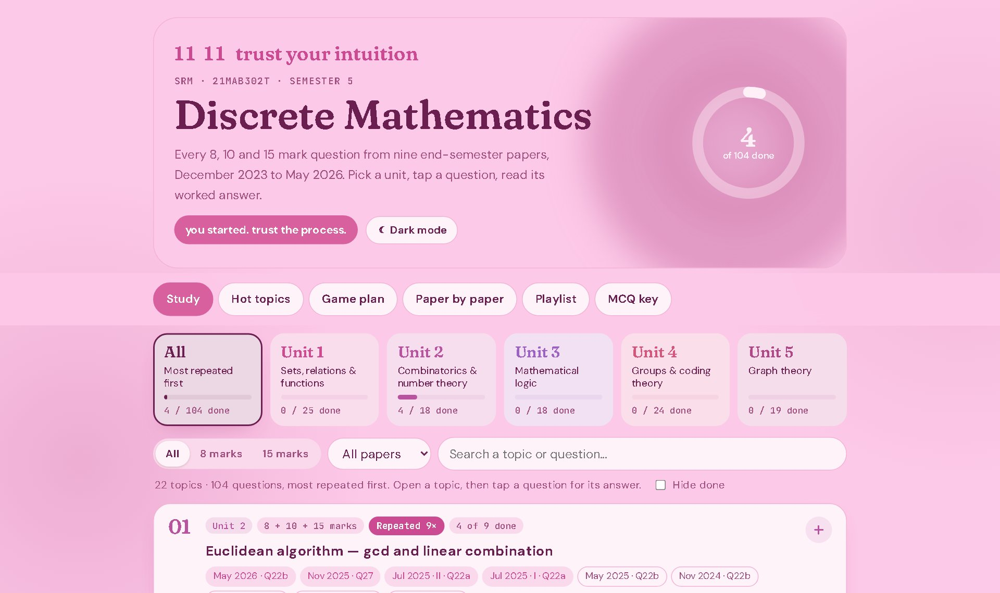

</div>

---

## 📖 Contents

1. [Why this exists](#-why-this-exists)
2. [Subjects and numbers](#-subjects-and-numbers)
3. [Feature tour](#-feature-tour)
   [Study](#1-study--topics-ranked-by-repeats) · [Answers](#2-every-question-opens-its-own-answer) · [Filters](#3-filters-and-search) · [Progress](#4-progress-tracking) · [Hot topics](#5-hot-topics--heatmap) · [Game plan](#6-game-plan) · [Paper by paper](#7-paper-by-paper) · [Playlist](#8-lecture-playlist) · [MCQ key](#9-mcq-key) · [Diagrams](#10-auto-drawn-state-diagrams) · [Themes](#11-three-looks) · [Sounds](#12-retro-sound-effects) · [Mobile](#13-made-for-phones) · [Offline sharing](#14-share-as-one-file)
4. [How it works](#️-how-it-works)
5. [Project structure](#️-project-structure)
6. [Run it locally](#️-run-it-locally)
7. [Adding a new subject](#-adding-a-new-subject)
8. [Notes](#-notes)

---

## 💡 Why this exists

Before end-sems everyone asks the same thing: *which questions actually come every time?* The papers are scattered PDFs, the same question is worded five different ways, and nobody has time to read nine papers per subject.

This project collects **every Part B and Part C question** from the last nine semesters, groups the ones that ask the same thing into a single **topic**, and sorts the topics by **how many papers they appeared in**. Each question gets a full exam-style answer, the matching lecture video, and a checkbox so you can track what you have revised.

## 📚 Subjects and numbers

| | Subject | Long questions | Topics | Papers | MCQ answers | Lecture videos | Open |
|---|---|:-:|:-:|:-:|:-:|:-:|---|
| 🧮 | **Discrete Mathematics** · 21MAB302T | 104 | 22 | 9 | 180 | 70 | [Pink](https://shru930.github.io/srm-sem5-pyq-hub/maths-study/) · [Dive](https://shru930.github.io/srm-sem5-pyq-hub/maths-study/dive.html) |
| 🤖 | **Formal Language & Automata** · 21CSC301T | 108 | 35 | 9 | 180 | 65 + 5 | [Pink](https://shru930.github.io/srm-sem5-pyq-hub/fla-study/) · [Dive](https://shru930.github.io/srm-sem5-pyq-hub/fla-study/dive.html) |
| 🌐 | **Computer Networks** · 21CSC302J | 120 | 54 | 10 | 180 | – | [Pink](https://shru930.github.io/srm-sem5-pyq-hub/cn-study/) |

Papers covered run from **November / December 2023 to May 2026**.

<div align="center">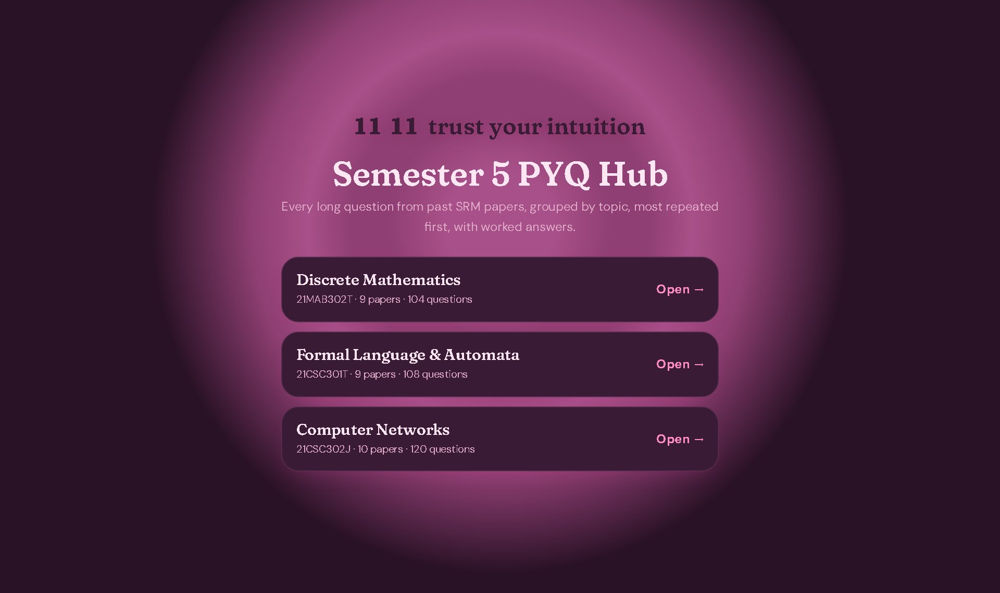<br><sub>The landing page links all three subjects.</sub></div>

---

## 🎯 Feature tour

### 1. Study · topics ranked by repeats

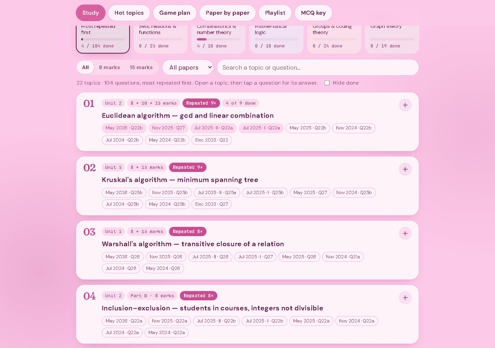

- **Unit tiles** across the top: pick *All* or one unit. Each tile shows how many of its questions you have finished.
- **Topic cards** are sorted with the most repeated topic first. Each card shows:
  - its **rank** (01, 02 …) and **unit**,
  - the **marks** it has carried (for example *8 + 10 + 15 marks*),
  - a **Repeated N×** badge: the number of papers that asked it,
  - a chip for **every paper and question number** it came as (*May 2026 · Q22b*, *Nov 2025 · Q27* …).
- **How questions are filed into units** follows the paper itself:
  - **Maths:** the **CO column** printed beside each question (CO1 = Unit 1 … CO5 = Unit 5).
  - **FLA:** the **question number**. Q21 is always Unit 1, Q22 Unit 2 … Q25 Unit 5, and the either/or pair shares the unit.

### 2. Every question opens its own answer

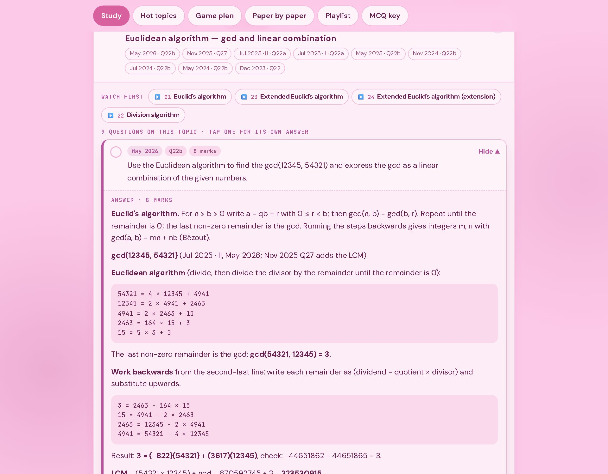

Open a topic, then tap any question inside it. Only **that question's answer** opens. Answers from different papers are never mixed into one long block.

- Answers are written the way you would write them in the exam: the definition or theorem first, then the full working.
- Numeric questions show **every step**: Warshall's W₀ to W₅ matrices, Euclid's division steps and back-substitution, inclusion–exclusion counts, code-word and decoding tables, Kruskal edge tables.
- **Watch first** chips above the questions link to the exact lecture video for that topic.
- *Same topic, other papers' versions* collects the other variants underneath, so you can practise the same method with different numbers.
- **Mark as done** at the end of each answer.

### 3. Filters and search

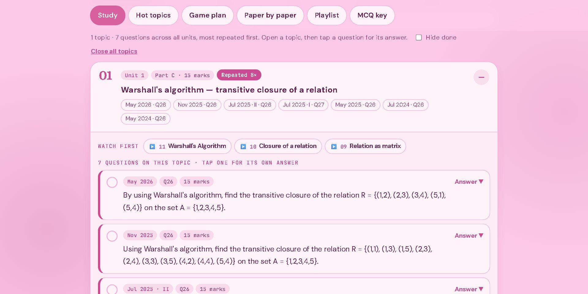

- **Marks:** All · 8 marks · 15 marks.
- **Paper:** show only one paper's questions.
- **Search:** any word in a topic name or question text. Above, *warshall* with *15 marks* leaves one topic with its 7 questions.
- **Hide done** removes questions you have already ticked.
- **Close all topics** folds everything back up.

### 4. Progress tracking

- Tick the circle beside any question (or press *Mark as done*).
- The **progress ring** in the header shows the overall total, and each **unit tile** fills up separately.
- The pill under the title changes as you go (*you started. trust the process.*).
- Progress is saved in the browser, **separately for each subject**, so it is still there next time you open the page. Nothing is sent anywhere.

### 5. Hot topics · heatmap

<table><tr>
<td width="50%"></td>
<td width="50%">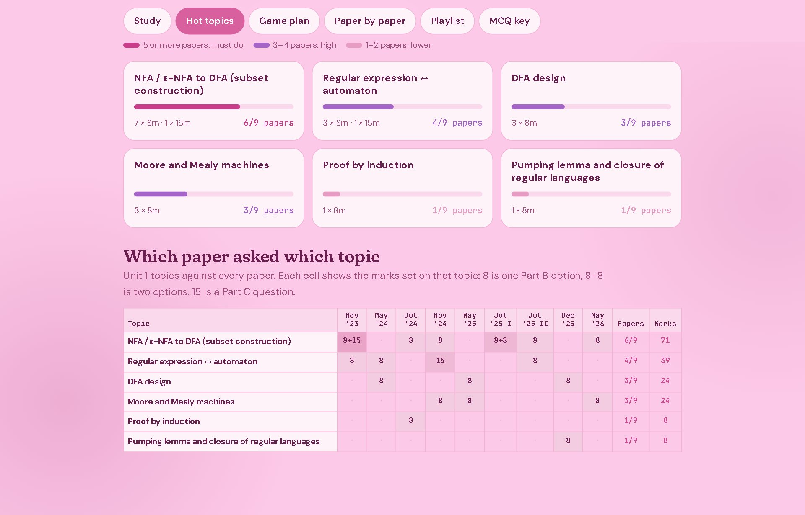</td>
</tr></table>

- **Left:** one card per topic for the chosen unit. The bar and colour show how many of the 9 papers asked it: **pink = 6 or more papers (must do)**, **purple = 3–4 (high)**, **light = 1–2 (lower)**.
- **Right:** *Which paper asked which topic*. Rows are topics, columns are papers, and each cell shows the marks set (8, 8+8, 15). The last columns total the papers and marks per topic.
- Click any topic to jump straight to its questions.

### 6. Game plan

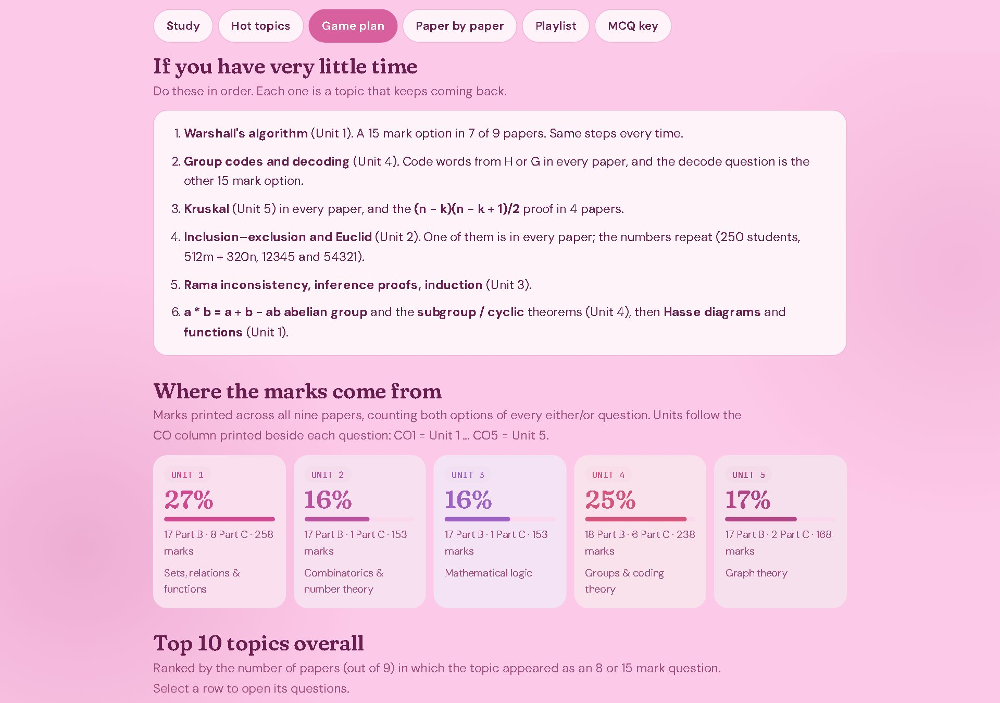

- **If you have very little time:** a short, ordered list of the topics that come back the most.
- **Where the marks come from:** each unit's share of all marks across the papers, split into Part B and Part C.
- **Top 10 topics overall** and **topics ranked within each unit**, each tagged *Must do*, *High* or *Lower*. Select a row to open its questions.

### 7. Paper by paper

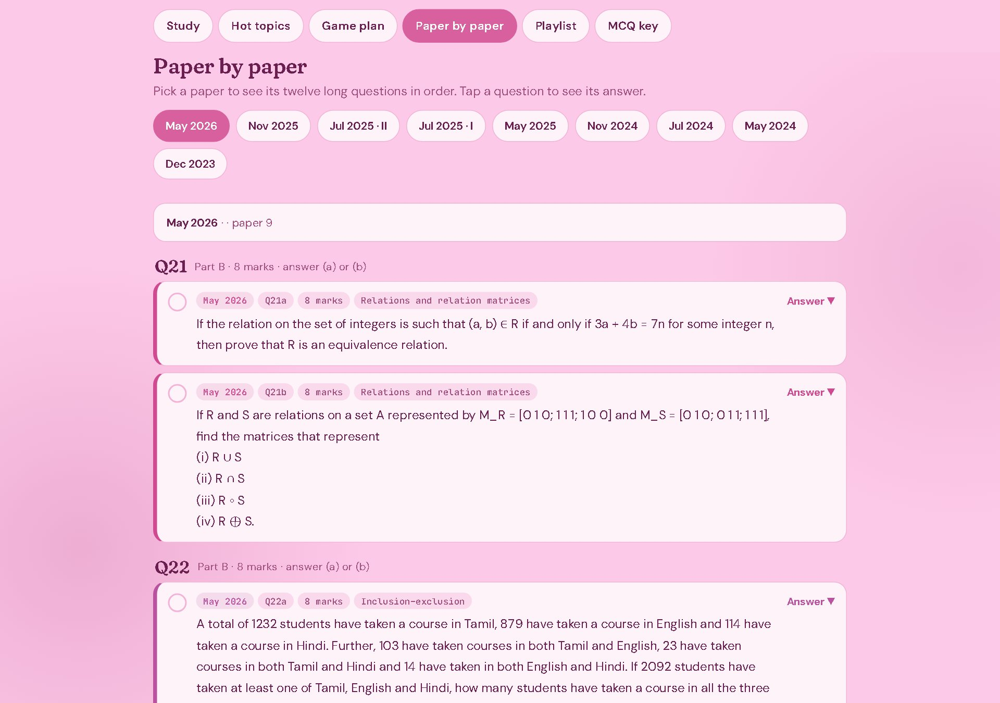

Pick a paper to see it exactly as it was set: Q21 to Q28 in order, with the **(a) / (b) either-or pairs** side by side and the marks for each. Each question links to its answer. This is useful as a timed mock exam.

### 8. Lecture playlist

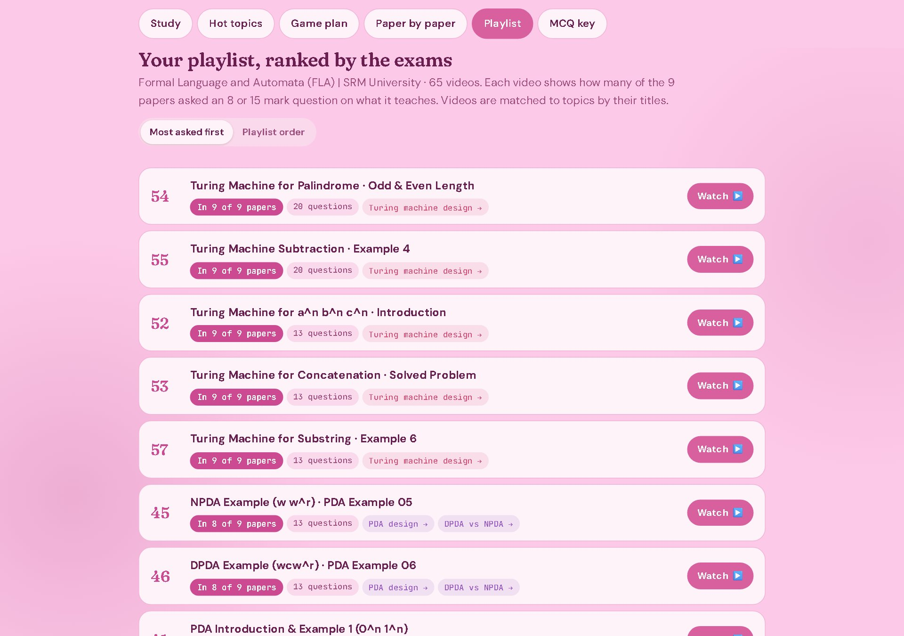

- Every video in the course playlist, in order, tagged with the **exam topics it covers**.
- **FLA:** Kalrav's 65-video playlist, plus 5 videos from Anita R for topics his playlist does not cover.
- **Maths:** Dr. E. Sujatha's (Mathemagic) five unit playlists, 70 videos.
- Videos that no exam question uses are dimmed, so you can skip them when time is short. You can also sort by *most asked*.
- **Watch** opens YouTube at that exact video inside the playlist.

### 9. MCQ key

<table><tr>
<td width="50%">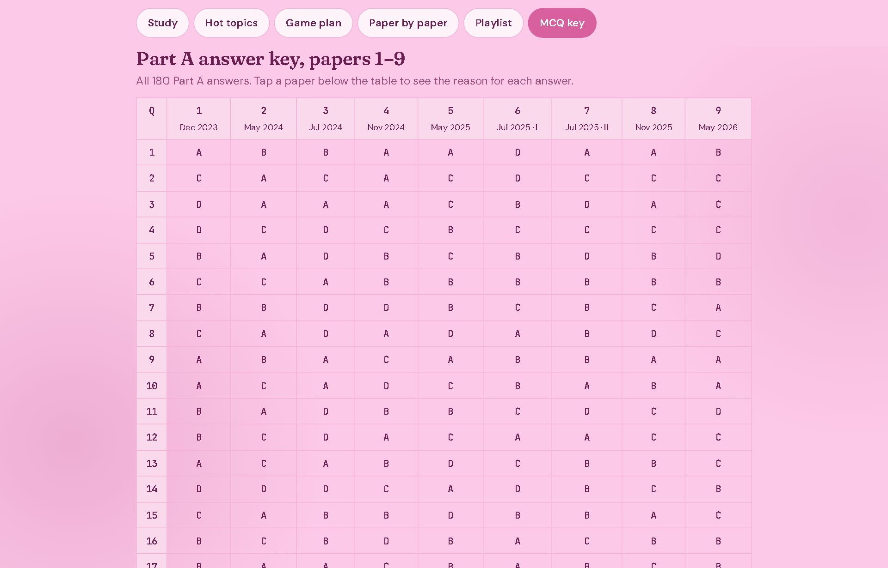</td>
<td width="50%">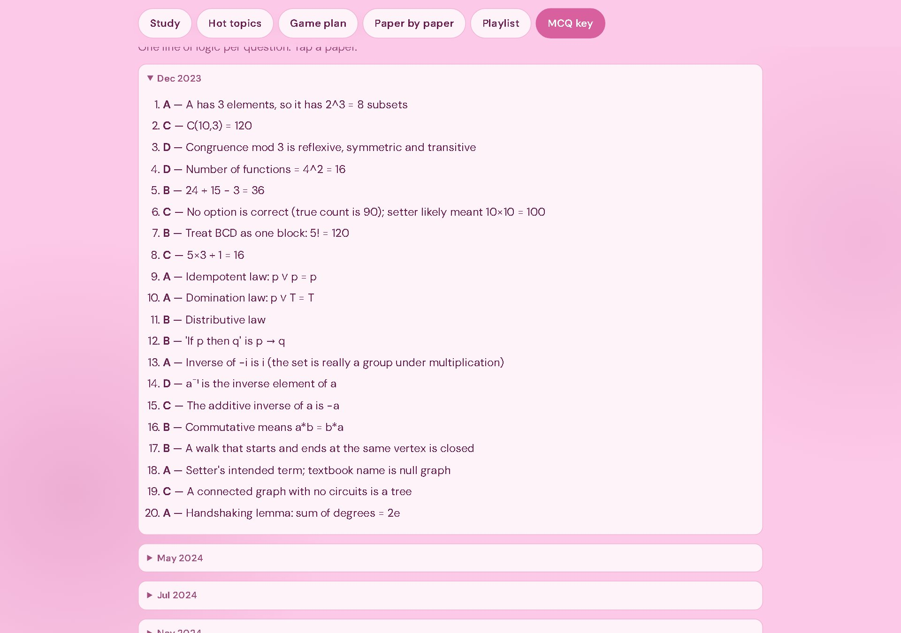</td>
</tr></table>

- **Answer table:** all 20 Part A answers for every paper on one screen.
- **Why each answer is right:** tap a paper to see a one-line reason for each answer (Maths).
- **Answers worth a second look:** questions where the paper is misprinted or no option is exactly right, with the answer chosen and why. For example, in Dec 2023 Q6 the true count is 90, but none of the options is 90.

### 10. Auto-drawn state diagrams

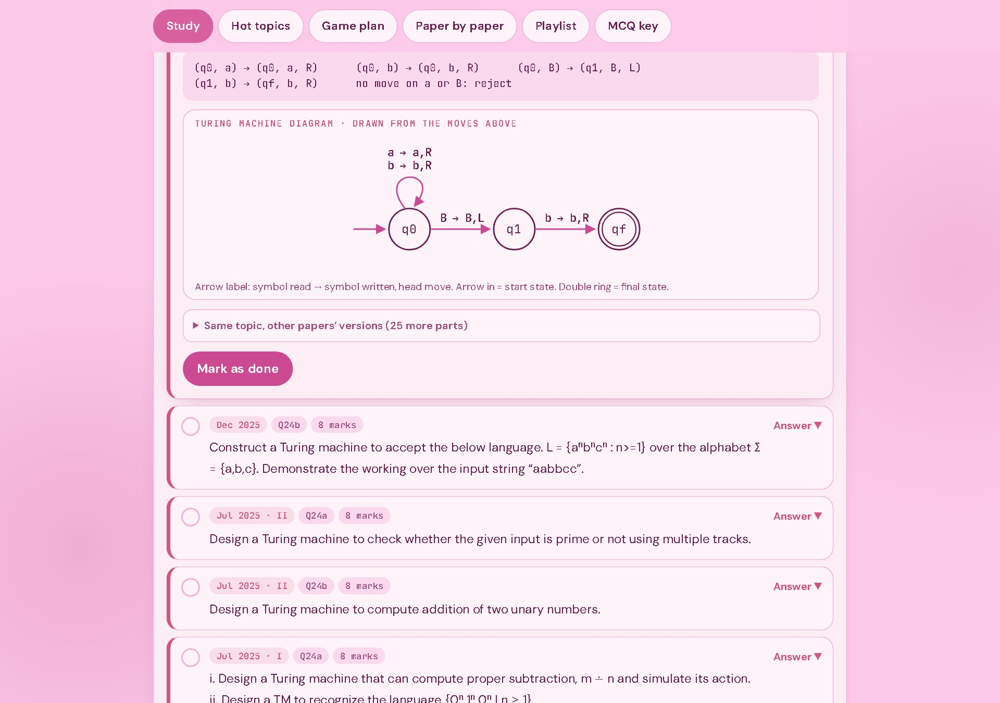

In FLA, every answer that contains a **transition table** (DFA, NFA, Moore, Mealy) or a **list of Turing machine / PDA moves** gets a state diagram drawn under it automatically:

- states laid out left to right in the order they are reached,
- an arrow into the start state and a double ring on final states,
- self-loops drawn above the state, and parallel edges merged into one label,
- the key below explains how to read each label (*read → write, move*).

The diagrams are generated from the same table that is in the answer, so they always match.

### 11. Three looks

<table><tr>
<td width="50%">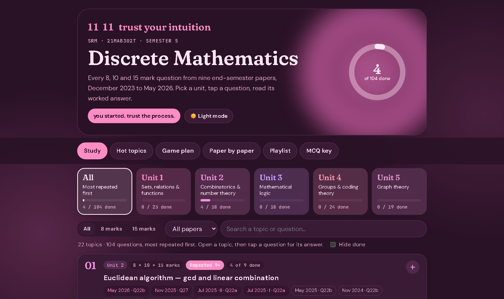<br><sub><b>Pink · dark mode</b>: one tap on the moon button</sub></td>
<td width="50%">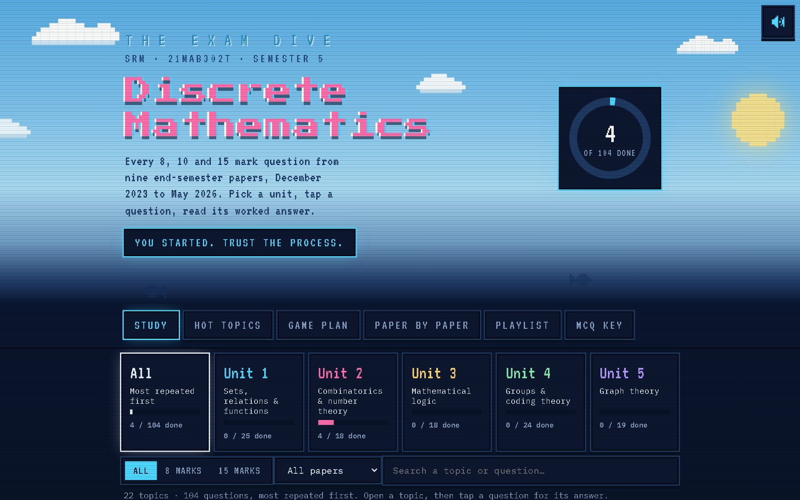<br><sub><b>The Exam Dive</b>: a pixel-art theme</sub></td>
</tr></table>

- **Pink 11:11** (default): soft pink with an aura glow, serif headings, and light and dark modes. Your choice is remembered.
- **The Exam Dive**: a pixel-art version. A blue sky with pixel clouds and a sun fades into a deep-sea navy page, with pixel fonts, glowing cyan and pink frames, and a faint scanline effect. It is available for Maths and FLA.

<div align="center">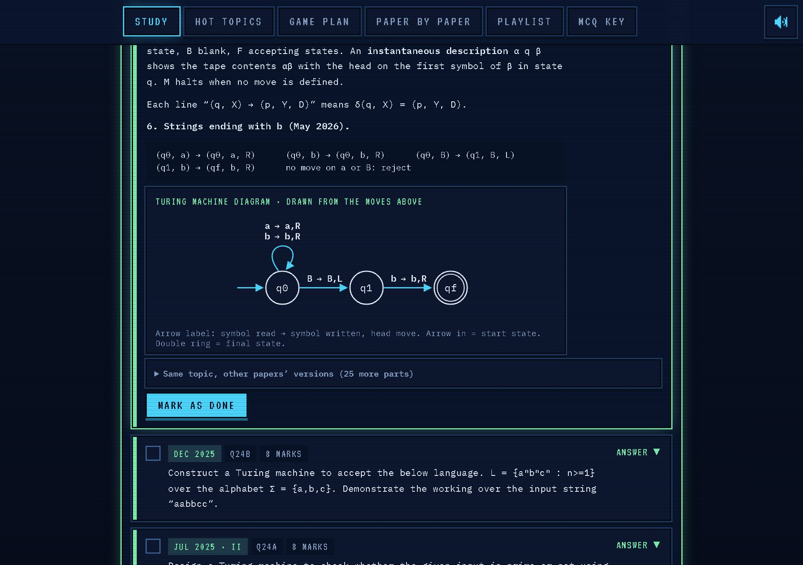<br><sub>Answers and diagrams restyled in the Dive theme.</sub></div>

### 12. Retro sound effects

The Dive pages play small chiptune sounds as you study:

| Action | Sound |
|---|---|
| Switch tab, unit or filter | two-note blip |
| Open a topic, question or section | rising bubble |
| Close it | falling bubble |
| Tick a question done | four-note coin arpeggio |
| Untick | low drop |
| Any other button | short click |

The sounds are **synthesised live with the Web Audio API**, so there are no audio files and they still work offline. A **speaker button** in the corner mutes them, and the choice is remembered.

### 13. Made for phones

<table><tr>
<td width="33%">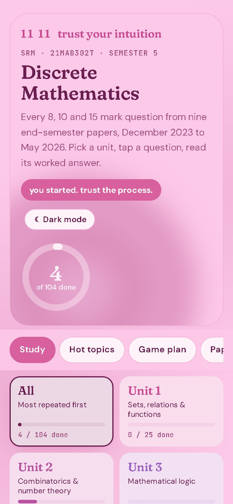</td>
<td width="33%">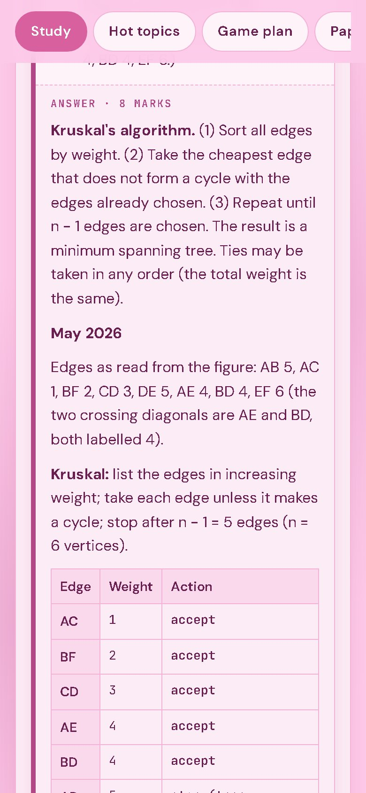</td>
<td width="33%">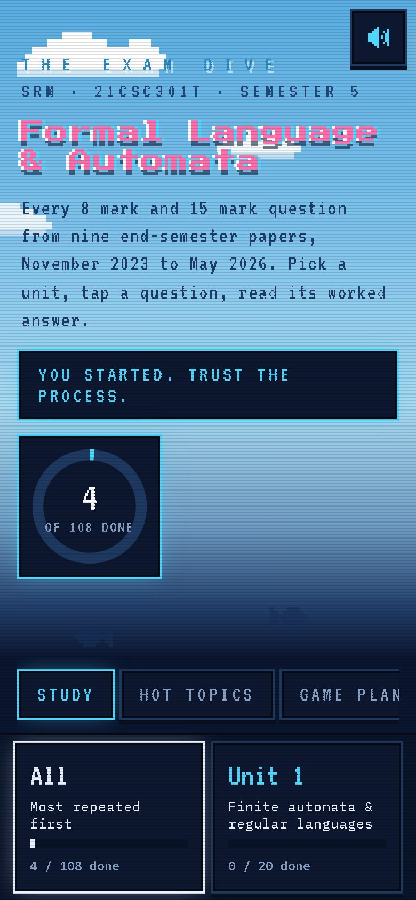</td>
</tr></table>

The layout reflows for small screens:
- unit tiles wrap into a grid,
- the tabs scroll sideways and stay pinned to the top,
- wide tables and diagrams scroll inside their own box, so the page itself never scrolls sideways.

### 14. Share as one file

Each page is **a single self-contained HTML file**: the data, styles, scripts and diagrams are all inside it. You can send it on WhatsApp as a document, and your friend opens it in any browser, **offline, with nothing to install**. The only things that need internet are the web fonts (it falls back to system fonts without them) and the YouTube links.

---

## ⚙️ How it works

### Build pipeline

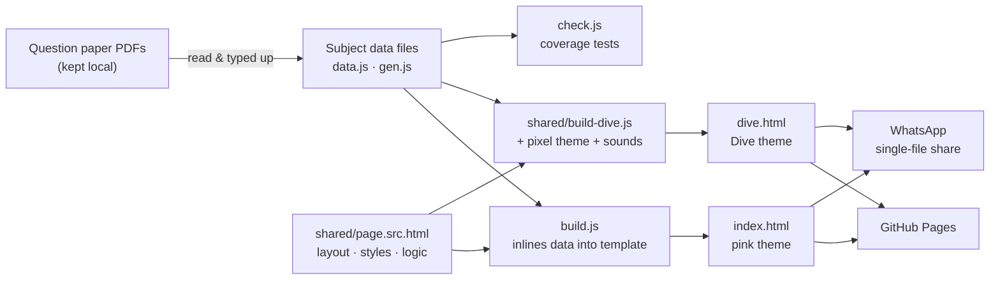

1. **Data, not pages.** Each subject is described in plain JavaScript data files:
   - `PAPERS`: the papers, with their names and dates.
   - `UNITS`: the five syllabus units.
   - `TOPICS`: each topic with its questions (paper, question number, marks, text) and its answer HTML.
   - `MCQ`, `MCQ_WHY`, `MCQ_NOTES`: the Part A key, reasons and flags.
   - `PLAYLIST`: the videos and a map from topic name to video numbers.
   - `SITE`: the subject's title, code and intro text.
2. **Generated working.** `gen.js` produces the long step-by-step tables (Warshall matrices, Euclid steps, coding tables, Kruskal) from small inputs, so the numbers are computed rather than typed by hand.
3. **One template for every subject.** `shared/page.src.html` contains all the HTML, CSS and JavaScript. `build.js` puts a subject's data into the template and writes one `index.html`.
4. **A second skin from the same source.** `shared/build-dive.js` takes the same template and data, then:
   - adds the pixel theme's CSS on top,
   - draws the pixel art (clouds, sun, fish) as CSS `box-shadow` grids generated from small ASCII sketches,
   - injects the sound script.

   Because nothing else changes, both themes always have identical content.
5. **Checks.** `check.js` confirms that every question of every paper appears exactly once, is filed under the right unit, and has an answer. The FLA `tools/` scripts also check that each question gets its own answer section.

### Inside the page

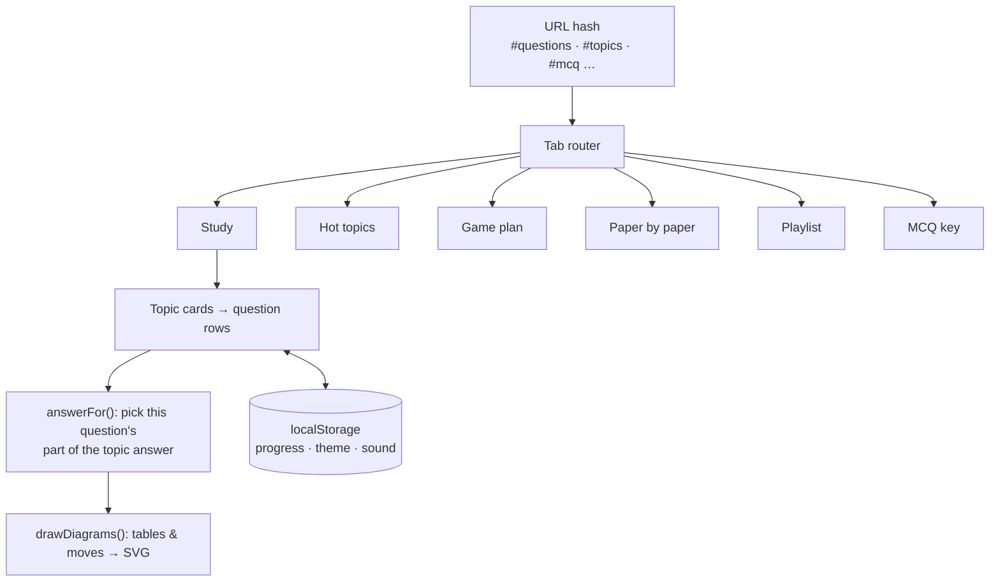

| Piece | What it does |
|---|---|
| **Tab router** | Each tab is a URL hash, so the browser back button works and a link can open a specific tab. |
| **Ranking** | Study cards are sorted by the number of *different papers* a topic appeared in, then by how many questions it has. The Game plan ranks by papers, then by total marks. |
| **`answerFor()`** | Finds the part of a topic's answer that belongs to the question you tapped. It uses, in order: an explicit question-to-block map, sections tagged with the paper name, or the paper-name headings inside the answer. |
| **`drawDiagrams()`** | Reads transition tables and move lists in an answer, works out the states and edges, places the states left to right, and draws the diagram as inline SVG that follows the theme's colours. |
| **Progress** | Ticked questions, the open unit, the theme and the sound setting are stored in `localStorage` under a key per subject (`dm-…`, `fla-…`), wrapped in `try/catch` so the page still works in private mode. |
| **Theming** | All colours are CSS custom properties. Light and dark mode swap the variables, and the Dive theme overrides them again. |
| **Sounds** | The Web Audio API creates square and sine oscillators with pitch sweeps and short fades. One click listener decides which sound fits the element clicked. |

---

## 🗂️ Project structure

```text
srm-sem5-pyq-hub/
├── index.html                landing page linking every subject
├── package.json              npm scripts: build · dive · check · serve
│
├── shared/
│   ├── page.src.html         ★ the one template every page is built from
│   └── build-dive.js         builds the pixel "Exam Dive" version of a subject
│
├── maths-study/              🧮 Discrete Mathematics (21MAB302T)
│   ├── data.js               papers, units, topics, answers, MCQ key, playlist
│   ├── gen.js                generated working: Warshall, Euclid, codes, Kruskal
│   ├── build.js              → index.html
│   ├── check.js              coverage test (prints ALL COVERED)
│   ├── index.html            built page · pink theme
│   └── dive.html             built page · Dive theme
│
├── fla-study/                🤖 Formal Language & Automata (21CSC301T)
│   ├── data1.js · data2.js   topics, answers, per-question split map, playlist
│   ├── gen.js                generated tables
│   ├── build.js · check.js
│   ├── tools/                unit check, answer-split check, block helpers
│   ├── index.html            built page · pink theme
│   └── dive.html             built page · Dive theme
│
├── cn-study/                 🌐 Computer Networks (21CSC302J)
│   ├── data.js · build.js
│   └── index.html            built page · pink theme
│
└── docs/screenshots/         images used in this README
```

## ▶️ Run it locally

You need [Node.js](https://nodejs.org/) 18 or newer. Python is only used for the local server.

```bash
git clone https://github.com/shru930/srm-sem5-pyq-hub.git
cd srm-sem5-pyq-hub

npm run build    # rebuild every index.html and dive.html
npm run check    # verify every question is covered and filed in the right unit
npm run serve    # then open http://localhost:8000
```

Or skip all of that and open any `index.html` or `dive.html` straight in a browser.

| Script | Does |
|---|---|
| `npm run build` | Builds CN, FLA and Maths, then both Dive pages |
| `npm run dive` | Rebuilds only the Dive pages |
| `npm run check` | Runs all coverage and unit checks |
| `npm run serve` | Serves the folder at `localhost:8000` |

## ➕ Adding a new subject

1. Make a folder such as `xyz-study/` with a `data.js` that defines `PAPERS`, `UNITS`, `TOPICS`, `MCQ` and `SITE`. Use `maths-study/data.js` as the example.
2. Copy `maths-study/build.js` into it and change the title.
3. Optionally add it to `SITES` in `shared/build-dive.js` for a Dive version.
4. Add a card for it to the root `index.html`, and its build command to `package.json`.

## 📝 Notes

- Answers follow the SRM syllabus and the course textbooks' wording, but they **have not been checked by faculty**. If you find a mistake, please open an issue.
- The scanned question papers are **not** included in this repository.
- Lecture videos belong to their creators and are only linked, not copied.

<div align="center">

---

<sub>Made for revision · good luck in the exams 🍀</sub>

</div>
