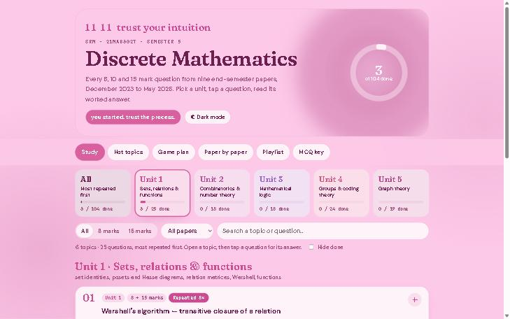
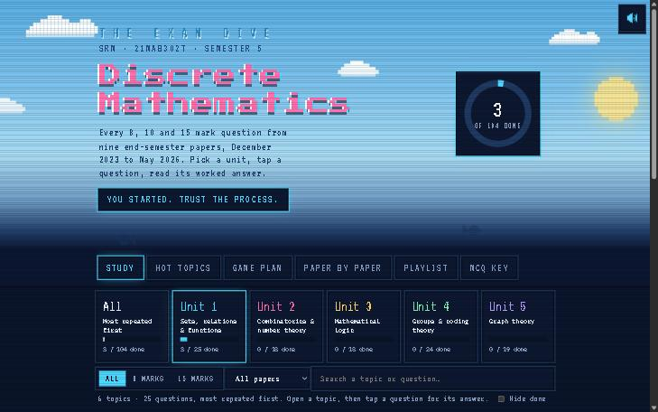
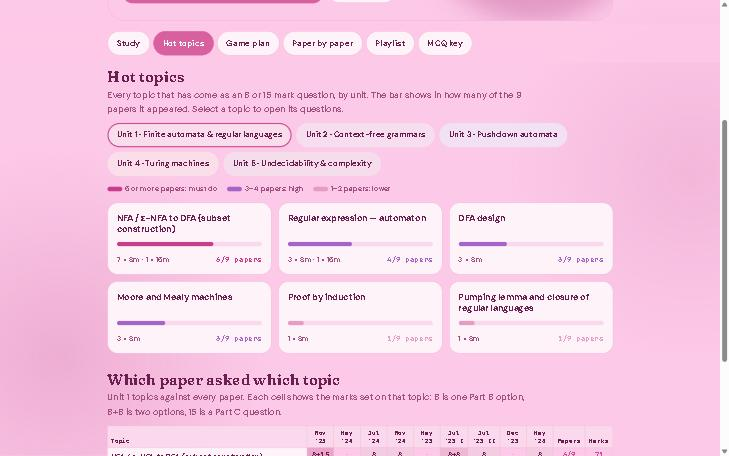
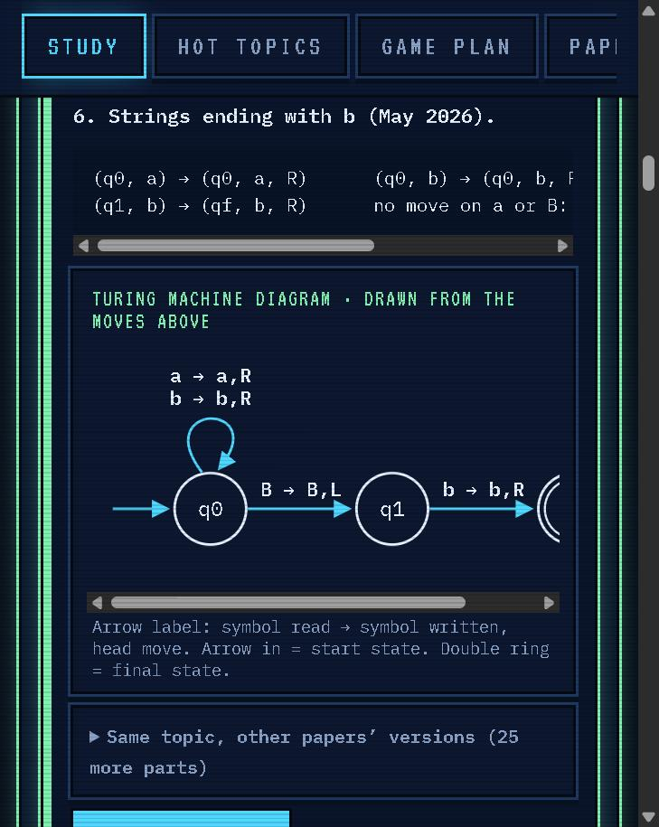

<div align="center">

# 🌸 SRM Semester 5 · PYQ Hub

**Every long question from nine semesters of end-sem papers, sorted by how often it repeats, with a worked answer for each one.**

[](https://shru930.github.io/srm-sem5-pyq-hub/)
[](https://shru930.github.io/srm-sem5-pyq-hub/maths-study/dive.html)


 

</div>

---

## 📚 Subjects

| | Subject | Questions | Topics | Papers | Open |
|---|---|:-:|:-:|:-:|---|
| 🧮 | **Discrete Mathematics** · 21MAB302T | 104 | 22 | 9 | [Pink](https://shru930.github.io/srm-sem5-pyq-hub/maths-study/) · [Dive](https://shru930.github.io/srm-sem5-pyq-hub/maths-study/dive.html) |
| 🤖 | **Formal Language & Automata** · 21CSC301T | 108 | 35 | 9 | [Pink](https://shru930.github.io/srm-sem5-pyq-hub/fla-study/) · [Dive](https://shru930.github.io/srm-sem5-pyq-hub/fla-study/dive.html) |
| 🌐 | **Computer Networks** · 21CSC302J | 120 | 54 | 10 | [Pink](https://shru930.github.io/srm-sem5-pyq-hub/cn-study/) |

## ✨ What's inside

| Tab | What it does |
|---|---|
| **Study** | Topics ranked by how many papers repeated them (*Repeated 7×*). Open a topic, tap a question, read its own answer. Tick questions off and your progress is saved. |
| **Hot topics** | A heatmap of which paper asked which topic, split by unit. |
| **Game plan** | Where the marks come from and what to revise first. |
| **Paper by paper** | Every paper's Part B and Part C in exam order. |
| **Playlist** | Each topic linked to the YouTube lecture that covers it (FLA: Kalrav + Anita R, Maths: Dr. E. Sujatha). |
| **MCQ key** | All Part A answers, a one-line reason for each, and flags on misprinted questions. |

<table>
<tr>
<td width="50%"><br><sub><b>Hot topics</b>: how often each topic shows up</sub></td>
<td width="50%"><br><sub><b>Auto-drawn diagrams</b>: FLA state diagrams are generated from the transition tables</sub></td>
</tr>
</table>

**Two looks.** A soft pink *11:11* theme with light and dark mode, and a pixel-art *Exam Dive* theme (sky to deep sea) with retro click sounds and a mute button.

**Share anywhere.** Every page is one self-contained HTML file, so it can be sent on WhatsApp as a document and opened offline.

## 🗂️ Project structure

```text
srm-sem5-pyq-hub/
├── index.html              landing page linking all subjects
├── shared/
│   ├── page.src.html       the page template every site is built from
│   └── build-dive.js       builds the pixel "Exam Dive" version of a site
├── maths-study/            Discrete Mathematics
│   ├── data.js             papers, units, topics, answers, MCQ key, playlist
│   ├── gen.js              generated worked tables (Warshall, Euclid, codes, Kruskal)
│   ├── build.js · check.js
│   └── index.html · dive.html     ← built pages
├── fla-study/              Formal Language & Automata
│   ├── data1.js · data2.js · gen.js
│   ├── build.js · check.js
│   ├── tools/              extra coverage checks (units, per-question answer split)
│   └── index.html · dive.html     ← built pages
├── cn-study/               Computer Networks
│   ├── data.js · build.js
│   └── index.html                 ← built page
├── docs/screenshots/
└── package.json            build / check scripts
```

## 🛠️ How it works

- **Data, not pages.** Each subject's questions, topics and answers live in plain JavaScript data files.
- **One template.** `shared/page.src.html` holds all the layout, styles and logic; `build.js` inlines a subject's data into it and writes a single `index.html`.
- **No dependencies.** Vanilla HTML, CSS and JavaScript. Progress is kept in `localStorage`, the tabs use the URL hash, diagrams are drawn as inline SVG, and the dive theme's sounds are synthesised with the Web Audio API.
- **Checked.** `check.js` scripts confirm that every question of every paper is covered exactly once and filed under the right unit.

## ▶️ Run it locally

Needs [Node.js](https://nodejs.org/).

```bash
npm run build    # rebuild every page
npm run check    # verify coverage
npm run serve    # then open http://localhost:8000
```

Or just open any `index.html` straight in a browser.

## 📝 Notes

- Answers were written to match the SRM syllabus and textbook wording. They have not been checked by faculty, so if something looks wrong, open an issue.
- The scanned question papers are not included in this repository.

<div align="center"><sub>Made for revision · good luck in the exams 🍀</sub></div>
